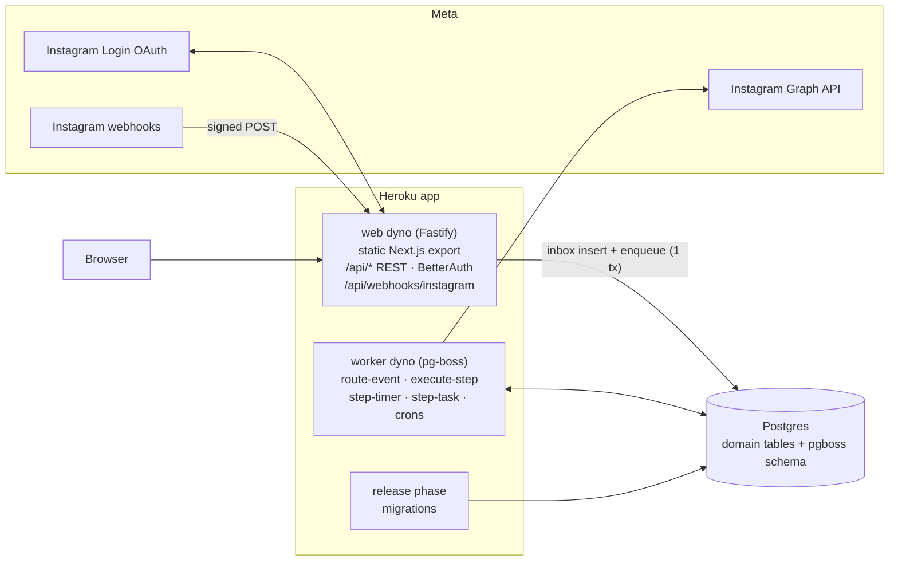
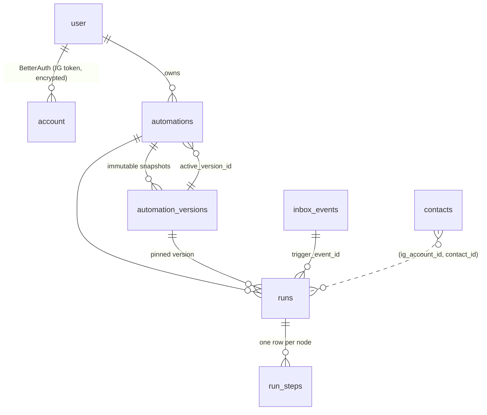
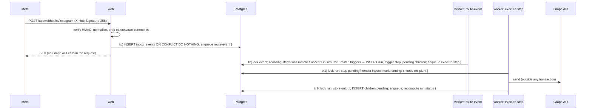

# Architecture

## 1. Goals and scope

Customers build automations that start when someone **comments on** or **DMs** their Instagram
account. The reference scenario:

> Someone comments "pricing" → reply "Sent you a DM!" → DM asking for an email → wait for the reply →
> once an email arrives, DM a link.

How general the system is was a judgment call. I picked these options:

| Decision | Choice | Why |
|---|---|---|
| Shape of an automation | **A graph of blocks** (trigger → actions/controls) with named ports | It covers the linear example, and adding branches (`received` / `timeout`) or new block types needs no schema change. A fixed "keyword → reply → DM" form would have to be rewritten for the next use case. |
| Graph topology | **Tree**: one trigger, each other block has exactly one parent | There are no joins, so I don't need join semantics ("wait for all parents?"). "What ran before me" is always clear, so template variables resolve unambiguously. Fan-out still works. |
| Data flow | `{{nodeId.output}}` string templates, checked at save time | Simple and safe (no expression language). The editor can offer exactly the variables from upstream blocks. |
| Waiting for a human | A first-class **`Wait for reply`** control block with timeout and validation (`any` / `email`, re-ask N times) | Waiting for a reply is the core of DM funnels. Making it a block (not a hidden flag) keeps the run state visible and lets the user branch on `timeout`. |
| Versioning | **Immutable versions**. Runs pin the version they started with | Editing a live automation must never change in-flight conversations. Rollback is just "make vN active". |
| Execution engine | **Postgres-backed state machine + pg-boss** | One datastore. State changes and job enqueues commit in one transaction. Easy to operate on Heroku. Temporal/Step Functions would add infrastructure without adding much at this scale (see §7). |

Blocks and event kinds are **declared**, and the engine only dispatches on the declarations:

* **Block spec** (`packages/core/src/blocks/<block>.ts`, `defineBlock`): schemas, ports, outputs,
  editor metadata and, for triggers, `trigger: { on: <event kind>, matches, output }`. Blocks
  that suspend declare `wait: { on: <event kind>, matches }`, where `matches` sees the waiting
  step's config and rendered inputs. The API, the worker and the editor all import the registry
  (`blockSpecs`), so validation, execution and UI cannot drift apart. `BlockType` is derived from the registry.
* **Block handler** (`apps/server/src/engine/blocks/<block>.ts`): the runtime half of every
  non-trigger block (see §4.1). The handler registry `satisfies` a type built from the specs, so a
  block without a handler does not compile.
* **Event spec** (`packages/core/src/events/<kind>.ts`, `defineEvent`): how the kind is extracted
  from a webhook entry and which contact it is about. Its server half (`engine/events.ts`) fetches
  the contact profile.

Adding a block means adding a spec file and a handler file and listing each in its registry. No
engine code changes.

Block catalog:

| Block | Kind | Config (static) | Inputs (templated) | Outputs | Ports |
|---|---|---|---|---|---|
| New comment | trigger | publications (all / list), keywords | — | `comment_data.{publication_id, comment_id, comment_text}`, `user_data.{user_id, username, full_name}` | out |
| New DM | trigger | — | — | `message_data.{user_id, message_id, message_type, message_payload}`, `user_data.*` | out |
| Send a DM | action | — | `user_id`, `message_text` | inputs + `execution_status`, `message_id` | out |
| Private reply | action | — | `comment_id`, `message_text` | inputs + `execution_status`, `message_id`, `user_id` (the comment's author, from Instagram's response) | out |
| Reply to comment | action | — | `comment_id`, `message_text` | inputs + `execution_status`, `reply_id` | out |
| Wait for reply | control | expect, timeoutHours, retryMessage, maxRetries | `user_id` | `message_id`, `message_text`, `email` | received, timeout |

## 2. Components



* **web**: Fastify. It serves the Next.js static export (same origin, so no CORS and the cookies
  are host-only), the REST API, BetterAuth, and webhook ingress.
* **worker**: pg-boss handlers. They are thin adapters around pure-ish engine functions in
  `apps/server/src/engine`.
* **packages/core**: pure domain logic with no I/O: block catalog, graph validation, templating,
  webhook normalization, trigger matching, DM addressing, run-status derivation. It is
  unit tested without a database.
* **Auth**: BetterAuth with a `genericOAuth` provider for Instagram Login. The Instagram account
  *is* the login. Its long-lived token lives only in BetterAuth's `account` row, encrypted
  (`encryptOAuthTokens`). There is no separate credential store, as the requirements ask.

Instagram Login quirks handled in `auth.ts`:
* the code exchange returns a short-lived token (sometimes wrapped in `data: []`), which is then
  exchanged for a 60-day token;
* there is no `refresh_token`: a daily cron refreshes the access token itself;
* there is no email, so a non-routable `<igId>@instagram.invalid` is synthesized for BetterAuth's
  user model;
* scopes must be comma-separated, and there is no PKCE;
* the account is subscribed to webhooks (`POST /me/subscribed_apps`) as part of sign-in.

## 3. Data model



| Table | Purpose | Key constraints |
|---|---|---|
| `user`, `session`, `account`, `verification` | BetterAuth. `account.accountId` = IG professional account id (= webhook `entry.id`) | unique `(providerId, accountId)`: one owner per IG account |
| `automations` | name, `status` (disabled/active/archived), `active_version_id`, timestamps | composite FK `(id, active_version_id)` → the version must belong to this automation |
| `automation_versions` | `version` number + `graph` JSONB, never updated | unique `(automation_id, version)` |
| `inbox_events` | every inbound event, normalized | unique `(ig_account_id, external_id)`, which is the **dedupe key** for Meta retries |
| `contacts` | people who interacted (username/name for `user_data` and the log) | PK `(ig_account_id, igsid)` |
| `runs` | one execution: pinned version, contact, status, start/end | unique `(automation_id, trigger_event_id)`; partial unique `(automation_id, contact_id) WHERE status IN (running, waiting)` |
| `run_steps` | per node: status, attempts, rendered input, output/error, wait expiry/retries | PK `(run_id, node_id)` is the **step idempotency key** |
| `pgboss.*` | job queue (managed by pg-boss) | — |

The graph is stored as JSONB on the version instead of normalized `nodes`/`edges` tables. A
version is always read and written whole and is immutable, so normalizing would add joins without
adding integrity: the graph is validated as a unit by `validateGraph` anyway. The routing query
only needs the trigger node, which is cheap to read from the active version.

## 4. Execution model

### 4.1 Event flow



1. **Ingress** (`http/webhooks.ts`, `engine/router.ts#ingestEvents`). Verify the signature over
   the raw body, normalize (each declared event kind extracts itself, `core/events/`), and insert into the inbox **and** enqueue
   `route-event` in the same transaction. pg-boss accepts our transaction as its `db`, so this is
   a transactional outbox: an event is stored iff its routing job exists. Duplicates from Meta
   retries hit the unique key and are silently dropped.
2. **Routing** (`routeEvent`). Upsert the contact, then look for a **waiting step of the account
   whose block declares the event is for it** (`wait.matches` over the step's config and inputs;
   Wait for reply matches DMs from its `user_id`), newest first, even in a run whose other
   branches are still running. Nothing is correlated app-wide: it is the block's call. If the
   block's handler (`on`) takes the event, the event is **consumed**: it does not also fire triggers, because it is an answer, not a new
   conversation. Otherwise every active automation whose trigger declares this event kind and
   matches gets a run. The trigger step is written as succeeded with the trigger's declared output,
   its children become `pending` and are enqueued.
3. **Steps** (`executor.ts`) are block-agnostic: the block's handler decides, the engine persists.
   They run in three phases, so a database transaction is never held during a network call:
   * *claim* (tx): lock the run row, check idempotency, render `{{…}}` inputs from finished steps,
     call `handler.start`, which returns one of:
     * `complete(port, output)`
     * `fail(error)`
     * `suspend(until, state)`
     * `effect(plan)`: the step is marked `running` (the block builds its Graph API call here);
   * *effect*: `handler.perform(plan)` calls Instagram;
   * *settle* (tx): write the output/error, create and enqueue the children for the port taken,
     recompute the run status.
4. **Suspended steps** (Wait for reply is the one today): the step becomes `waiting` with
   `expires_at` and block-private `state`, and a `step-timer` job is scheduled with `startAfter`.
   While it waits:
   * a matching event goes to `handler.on[kind]`, which returns `complete`, `stay` (new state,
     optional follow-up `step-task` jobs) or `ignore`;
   * the deadline goes to `handler.onTimer`.

   An event and the deadline race safely (§5). For Wait for reply:
   * a valid reply continues through `received`, the deadline through `timeout`;
   * an invalid reply (no email) is consumed, and a `send-retry` task re-asks with `retryMessage`
     up to `maxRetries` times; after that the step waits silently until the deadline.
5. **Run status** is *derived* from the step statuses (`deriveRunStatus`): any
   pending/running → `running`; else any waiting → `waiting`; else any failed → `failed`; else
   `succeeded`. Since it is recomputed under the run lock after every transition, it cannot drift
   from the steps. In the detailed view, blocks that were never reached in a finished run are shown
   as `skipped`.

### 4.2 Instagram's messaging rules are Instagram's to enforce

Instagram does not allow cold DMs: a normal DM needs the user to have messaged the account in the
last 24h, and the only other way to reach a commenter is a single **private reply** to their
comment within 7 days. The app does **not** imitate these rules: there are no window timers or
per-comment claims. It makes the call and Instagram decides. A rejection is a permanent Graph API
error that fails the step with Instagram's own message, visible in the execution log.

How a DM is addressed is explicit in the graph, as two blocks: **Private reply** sends to a
comment (`recipient: {comment_id}`) and **Send a DM** sends to a user id (`recipient: {id}`). The
comment templates open the conversation with a private reply to the triggering comment; later
DMs, sent once the user has answered, are plain DMs.

In mock mode, the fake Instagram (`apps/server/src/instagram/mock.ts`) enforces these rules
itself. It learns about comments and DMs from the simulator, so local runs fail exactly where real
ones would (e.g. two automations on one comment: the second private reply is rejected).

### 4.3 Example run (pricing template)

```
trigger(comment "pricing")  succeeded   → comment_data, user_data
reply                       succeeded   "Sent you a DM!"                  (POST /{comment}/replies)
ask                         succeeded   private reply asking for email    (recipient.comment_id)
wait (expect=email)         waiting …   user: "what?"  → re-ask (1/2)
                            succeeded   user: "bob@x.io" → output.email
send_link                   succeeded   "Here is the link … bob@x.io"     (recipient.id, window open)
```

## 5. Reliability and concurrency

| Concern | Mechanism |
|---|---|
| Meta retries / duplicate deliveries (up to 36h) | `inbox_events` unique `(account, external_id)`; `runs` unique `(automation, trigger_event)` |
| Lost events between "stored" and "queued" | Transactional enqueue (pg-boss `send({ db: tx })`) |
| Missed webhooks (Meta drops after 36h; comments need Advanced Access) | `reconcile-comments` cron polls recent comments on watched posts into the **same** deduplicated inbox |
| Worker crash mid-step | pg-boss expiry/retry re-runs the job. `run_steps` status makes the claim idempotent: only `pending`, or `running` from a crashed attempt, executes |
| Duplicate side effects | **At-least-once.** The Graph API has no idempotency keys, so a crash between "sent" and "settled" can resend once. The window is a few ms. A resent private reply is rejected by Instagram itself |
| Transient vs permanent API errors | `MetaApiError.transient` (5xx, throttling codes 1/2/4/17/32/341/613, network) → retried with exponential backoff, up to 8 times. Permanent errors (4xx, including Instagram's messaging-rule rejections) or the last attempt → step `failed` with Instagram's message, run `failed` |
| Concurrent jobs of the same run (fan-out branches, reply vs timeout) | Every transition locks the run row (`SELECT … FOR UPDATE`), and a suspended step's status is re-checked under that lock, so the reply/timeout race has a single winner |
| Same person comments "pricing" 3 times | Partial unique index: one in-flight run per (automation, contact). Later comments are recorded but don't start new runs, so no spam |
| Several automations waiting on one person | The reply goes to the most recently started waiting step (the latest question asked) |
| Reply arrives before the wait step starts | When a step suspends, the executor replays the events its block matches, received since the previous step started (`replayEarlyEvents`) |
| Editing a live automation | Versions are immutable and runs pin `version_id` |
| Loops (our reply triggers our automation) | Normalizer drops `is_echo` messages and comments authored by the account itself |
| Webhook spoofing | HMAC-SHA256 over the raw body with the app secret, constant-time compare |
| Token expiry | Daily refresh of tokens that are >24h old and expire within 14 days. An expired token fails steps with "reconnect" instead of retrying |
| Deploys (web and worker briefly on different releases) | Forward-only, additive migrations in the `release` phase; job payloads only ever gain fields |
| Throughput | Webhook path is 1 insert + 1 enqueue. Workers use LISTEN/NOTIFY wakeups (polling as fallback) and run with per-queue concurrency. Scale by adding worker dynos: jobs are claimed with `SKIP LOCKED` |

Known limitations / next steps:
* **Per-account rate limiting.** Instagram allows ~200 calls/hour/account for some endpoints. pg-boss
  `groupConcurrency` keyed by IG account, or a token bucket in Postgres, would smooth bursts
  (a viral post). Today, throttling errors are retried with backoff.
* **Disconnect / data deletion callbacks** from Meta should mark the account disconnected, pause its
  automations and purge data. The pages exist, but the callbacks are not wired up yet.
* **Inbox retention**: `inbox_events` and finished runs should be partitioned or pruned by age.
* The early-reply catch-up has a sub-millisecond race window if the reply's routing transaction
  reads the run before the wait step commits. A per-contact advisory lock in both paths would close it.

## 6. API

| Method | Path | |
|---|---|---|
| GET/POST | `/api/auth/*` | BetterAuth (`sign-in/social` with `provider: "instagram"`, callback `/api/auth/callback/instagram`) |
| GET | `/api/me` | current user + IG account |
| GET/POST | `/api/automations` | list (with active version, trigger type, run count) / create |
| GET/PATCH | `/api/automations/:id` | detail with versions / rename, status, active version |
| POST | `/api/automations/:id/versions` | save the graph as a new version (validated; optionally activate) |
| GET | `/api/automations/:id/versions/:vid` | a version's graph |
| GET | `/api/templates` · POST `/api/templates/:id/instantiate` | templates / fill the params and create |
| GET | `/api/runs?automationId&status&cursor` | execution log, keyset-paginated, with `{status: count}` counters |
| GET | `/api/runs/:id` | run + all steps (incl. skipped) + graph, for the table and graph views |
| GET | `/api/instagram/media` | posts, for the publication picker |
| GET/POST | `/api/webhooks/instagram` | Meta verification handshake / events |
| POST | `/api/dev/simulate` | dev/demo only: inject a Meta-shaped comment/DM through the real pipeline |

## 7. Alternatives considered

* **Temporal / DBOS / Inngest**: durable execution with `waitForEvent` would replace about 300 lines
  of state machine. I rejected it for this scope: it adds a cluster or a vendor, it is not on the
  given stack, and correlating "wait for *this* person's DM" still needs our own contact index. The
  Postgres design keeps run state queryable with SQL, which is exactly what the execution log needs.
* **One job per run (an interpreter loop)** instead of one job per step: simpler, but a long wait
  would occupy a job slot or need the same suspend/resume machinery anyway. Steps as jobs also give
  per-step retries and attempts for free.
* **A full expression language** for inputs (JSONata, JS): more power, more attack surface and
  harder validation. References only, validated against declared outputs, is enough for messaging
  flows. Conditions would be a new `control.condition` block with `true`/`false` ports.
