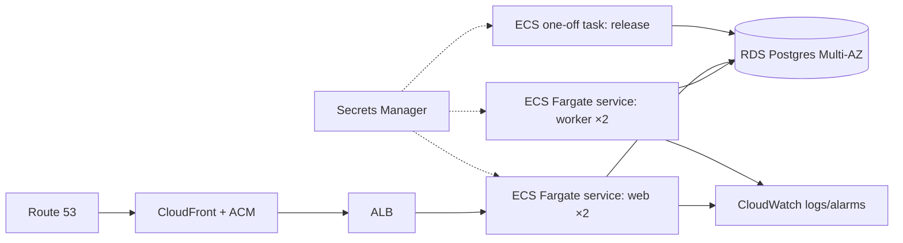

# Deployment

## Heroku (demo)

One app, one slug, three process types (`Procfile`):

| Process | Command | Role |
|---|---|---|
| `release` | `node dist/release.js` | SQL migrations (advisory-locked) + pg-boss schema/queues, before new dynos get traffic |
| `web` | `node dist/web.js` | Fastify: static Next.js export, `/api/*`, BetterAuth, webhooks |
| `worker` | `node dist/worker.js` | pg-boss handlers + crons (token refresh, comment reconciler) |

```bash
heroku create automations
heroku addons:create heroku-postgresql:essential-0
heroku config:set NODE_ENV=production INSTAGRAM_MODE=live \
  BETTER_AUTH_URL=https://demo.example.com BETTER_AUTH_SECRET=$(openssl rand -base64 32) \
  INSTAGRAM_APP_ID=... INSTAGRAM_APP_SECRET=... META_WEBHOOK_VERIFY_TOKEN=$(openssl rand -hex 16) \
  COMMENT_RECONCILER=true
git push heroku main
heroku ps:type web=basic worker=basic && heroku ps:scale web=1 worker=1
heroku domains:add demo.example.com && heroku certs:auto:enable   # CNAME demo -> *.herokudns.com (DNS only)
```

The build runs `pnpm build`: the Next.js static export goes to `apps/web/out`, and the server is
bundled with tsup to `apps/server/dist` (with `@app/core` inlined).

Meta app configuration:
* OAuth redirect URI: `https://demo.example.com/api/auth/callback/instagram`
* Webhook callback: `https://demo.example.com/api/webhooks/instagram`, verify token = `META_WEBHOOK_VERIFY_TOKEN`, fields `comments`, `messages`
* Privacy policy `/privacy/`, data deletion `/data-deletion/`

Sizing: demo = web Basic ×1, worker Basic ×1, Postgres Essential-0 (\~$19/mo). Production = web
Standard-1X ×2 (preboot), worker Standard-2X ×2, Postgres Standard-0 (\~$200/mo). Basic dynos don't
sleep, which matters because webhooks must not hit cold starts.

Deploy safety: with preboot, old and new code overlap for about 3 minutes, so migrations are
additive only, and job payloads only gain optional fields. `heroku rollback` restores the slug, not
the schema, which is one more reason migrations are forward-compatible.

Platform risk: in Feb 2026 Heroku moved to "sustaining engineering" mode. That is fine for a demo,
and the AWS plan below is the exit path.

### CI/CD (GitHub Actions)

* `.github/workflows/deploy.yml` runs on push to `main` (or manually). It runs typecheck and tests
  against Postgres, then waits for approval, then provisions the app if it is missing (app,
  Postgres, domain), syncs the config vars from GitHub secrets, pushes to Heroku (the release
  phase migrates), sets the dyno types and runs a health check.
* `.github/workflows/destroy.yml` is manual only. You type the app name to confirm, then approve,
  and it runs `heroku apps:destroy` (the database is deleted too). Deploying again recreates
  everything.
* The approval gate is the `production` environment with required reviewers. Secrets live in that
  environment, so they are only released to approved jobs. The app name and domain are repository
  variables.

## AWS alternative (Terraform)

The same three processes map 1:1, and Postgres remains the only stateful component. No code changes
are needed: the queue is in Postgres, so there is no SQS rewrite.



| Heroku | AWS |
|---|---|
| slug | ECR image (a Dockerfile, not in the repo yet; one image, three commands) |
| web dyno + router | ECS Fargate service behind ALB (health check `/api/health`), CloudFront in front for static assets |
| worker dyno | ECS Fargate service, no load balancer, scaled on pg-boss queue depth via a custom CloudWatch metric |
| release phase | ECS `run-task` in the CI pipeline before `update-service` (or a CodeDeploy hook) |
| Heroku Postgres | RDS PostgreSQL Multi-AZ (or Aurora), with RDS Proxy **not** placed in front of the worker, because LISTEN/NOTIFY needs session pinning |
| config vars | Secrets Manager / SSM, injected as task secrets |
| ACM on Heroku | ACM cert on ALB/CloudFront, Route 53 alias |

Terraform layout (sketch):

```
infra/
  modules/
    network/      # VPC, 2 AZs, public subnets (ALB), private subnets (tasks, RDS), NAT
    database/     # aws_db_instance (multi_az, backups, PITR), parameter group, SG from tasks only
    service/      # aws_ecs_task_definition + aws_ecs_service, reused for web and worker
    edge/         # ALB, target group, listener 443, ACM, Route 53, CloudFront
  envs/
    demo/main.tf  # small instances, single AZ RDS
    prod/main.tf  # multi-AZ, autoscaling, alarms
```

```hcl
module "web" {
  source        = "../../modules/service"
  name          = "web"
  image         = "${aws_ecr_repository.app.repository_url}:${var.release}"
  command       = ["node", "apps/server/dist/web.js"]
  desired_count = 2
  target_group  = module.edge.target_group_arn
  secrets       = local.app_secrets   # DATABASE_URL, BETTER_AUTH_SECRET, INSTAGRAM_APP_SECRET, ...
}

module "worker" {
  source        = "../../modules/service"
  name          = "worker"
  image         = "${aws_ecr_repository.app.repository_url}:${var.release}"
  command       = ["node", "apps/server/dist/worker.js"]
  desired_count = 2
  secrets       = local.app_secrets
}
```

What AWS adds over Heroku: true rolling deploys with health-check gating and automatic rollback
(ECS deployment circuit breaker), private networking for the database, autoscaling the worker on
queue depth, and WAF on the webhook path (Meta publishes no IP list, so the protection is the HMAC
signature plus rate limiting). The cost is more moving parts. For the demo, Heroku is the better fit.
